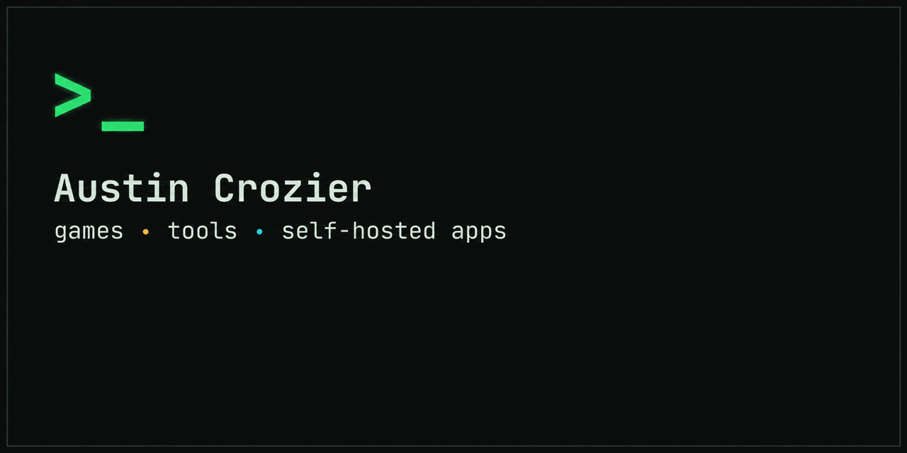

I build games, tools and self-hosted apps. Python and AI engineering, from the Mackay region, QLD.

### Public on GitHub

- [**nethealth**](https://github.com/Aussietin/nethealth): a terminal network-health monitor. Live Textual TUI, per-target DNS, ping, HTTP and SSL checks, on-demand traceroute, an in-app speed test and history reports. MIT.
- [**PhotoSync**](https://github.com/Aussietin/PhotoSync): a self-hosted photo library with local CLIP search, optional on-device face grouping and duplicate detection. Runs offline on my own server. MIT.

### Games and other work

Games, and tools whose code is not public, are on the portfolio with a status label on each: [aussietin.github.io](https://aussietin.github.io).

### How I work

Built with Claude Code and Codex as pair tools; design, decisions and testing are mine.

Python · TypeScript · FastAPI · Docker · Godot · three.js · homelab
